<!-- Profile README for github.com/kaifsakes. Facts match muhammadkaif.work. Graphics: node scripts/build.mjs && node scripts/readme.mjs -->

<a href="https://muhammadkaif.work"><picture><source media="(prefers-color-scheme: dark)" srcset="assets/hero-dark.svg"><source media="(prefers-color-scheme: light)" srcset="assets/hero-light.svg"></picture></a>

<a href="https://muhammadkaif.work"><picture><source media="(prefers-color-scheme: dark)" srcset="assets/btn-portfolio-dark.svg"><source media="(prefers-color-scheme: light)" srcset="assets/btn-portfolio-light.svg"></picture></a>
<a href="https://www.linkedin.com/in/kaifsake"><picture><source media="(prefers-color-scheme: dark)" srcset="assets/btn-linkedin-dark.svg"><source media="(prefers-color-scheme: light)" srcset="assets/btn-linkedin-light.svg"></picture></a>
<a href="mailto:hire@muhammadkaif.work"><picture><source media="(prefers-color-scheme: dark)" srcset="assets/btn-hire-dark.svg"><source media="(prefers-color-scheme: light)" srcset="assets/btn-hire-light.svg"></picture></a>
<a href="mailto:partner@muhammadkaif.work"><picture><source media="(prefers-color-scheme: dark)" srcset="assets/btn-partner-dark.svg"><source media="(prefers-color-scheme: light)" srcset="assets/btn-partner-light.svg"></picture></a>
<a href="https://muhammadkaif.work/cv"><picture><source media="(prefers-color-scheme: dark)" srcset="assets/btn-cv-dark.svg"><source media="(prefers-color-scheme: light)" srcset="assets/btn-cv-light.svg"></picture></a>

I write firmware and build edge-AI and medical-wearable systems, from board bring-up and RTOS drivers to BLE, IoT dashboards and models that run on the device. Based in Pakistan; **Embedded Systems Engineer at ChipMango** (Aug 2026 – present), previously Technical Project Manager at Geocell Canada and Firmware Team Lead at MachaDev Engineering. Full story on **[muhammadkaif.work](https://muhammadkaif.work)**.

<picture><source media="(prefers-color-scheme: dark)" srcset="assets/stats-dark.svg"><source media="(prefers-color-scheme: light)" srcset="assets/stats-light.svg"></picture>

## Selected work

<a href="https://muhammadkaif.work/work/ppg-glucose"><picture><source media="(prefers-color-scheme: dark)" srcset="assets/project-ppg-glucose-dark.svg"><source media="(prefers-color-scheme: light)" srcset="assets/project-ppg-glucose-light.svg"></picture></a>
<a href="https://muhammadkaif.work/work/fall-detection"><picture><source media="(prefers-color-scheme: dark)" srcset="assets/project-fall-detection-dark.svg"><source media="(prefers-color-scheme: light)" srcset="assets/project-fall-detection-light.svg">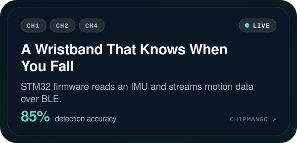</picture></a>
 
<a href="https://muhammadkaif.work/work/telecom-monitoring"><picture><source media="(prefers-color-scheme: dark)" srcset="assets/project-telecom-monitoring-dark.svg"><source media="(prefers-color-scheme: light)" srcset="assets/project-telecom-monitoring-light.svg">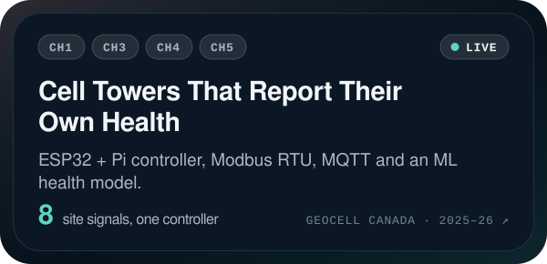</picture></a>
<a href="https://muhammadkaif.work/work/mirpur-smart-classrooms"><picture><source media="(prefers-color-scheme: dark)" srcset="assets/project-mirpur-smart-classrooms-dark.svg"><source media="(prefers-color-scheme: light)" srcset="assets/project-mirpur-smart-classrooms-light.svg">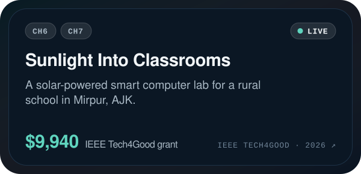</picture></a>
 
<a href="https://muhammadkaif.work/work/rk3588-edge-ai"><picture><source media="(prefers-color-scheme: dark)" srcset="assets/project-rk3588-edge-ai-dark.svg"><source media="(prefers-color-scheme: light)" srcset="assets/project-rk3588-edge-ai-light.svg"></picture></a>
<a href="https://muhammadkaif.work/work/ebike-telemetry"><picture><source media="(prefers-color-scheme: dark)" srcset="assets/project-ebike-telemetry-dark.svg"><source media="(prefers-color-scheme: light)" srcset="assets/project-ebike-telemetry-light.svg"></picture></a>
 
<a href="https://muhammadkaif.work/work/foodease"><picture><source media="(prefers-color-scheme: dark)" srcset="assets/project-foodease-dark.svg"><source media="(prefers-color-scheme: light)" srcset="assets/project-foodease-light.svg"></picture></a>
<a href="https://muhammadkaif.work/work/magnetic-agv"><picture><source media="(prefers-color-scheme: dark)" srcset="assets/project-magnetic-agv-dark.svg"><source media="(prefers-color-scheme: light)" srcset="assets/project-magnetic-agv-light.svg"></picture></a>
 
<a href="https://muhammadkaif.work/work/semg-ankle"><picture><source media="(prefers-color-scheme: dark)" srcset="assets/project-semg-ankle-dark.svg"><source media="(prefers-color-scheme: light)" srcset="assets/project-semg-ankle-light.svg"></picture></a>
<a href="https://muhammadkaif.work/work/lung-sounds"><picture><source media="(prefers-color-scheme: dark)" srcset="assets/project-lung-sounds-dark.svg"><source media="(prefers-color-scheme: light)" srcset="assets/project-lung-sounds-light.svg"></picture></a>

Case studies, photos and more on **[muhammadkaif.work/work](https://muhammadkaif.work/work)**.

## Seven channels

<a href="https://muhammadkaif.work/expertise"><picture><source media="(prefers-color-scheme: dark)" srcset="assets/expertise-dark.svg"><source media="(prefers-color-scheme: light)" srcset="assets/expertise-light.svg">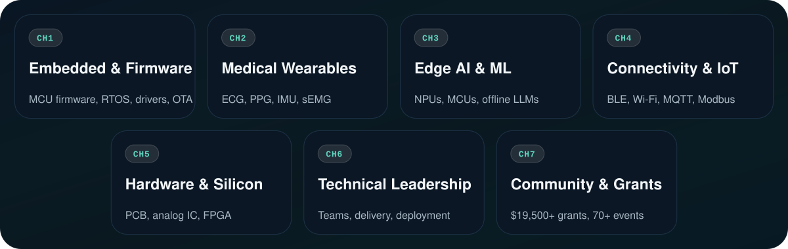</picture></a>

## Leadership

- General Secretary, IEEE PES/PELS Joint Chapter, Islamabad (Jun 2025 – present)
- General Secretary, IEEE SIGHT (Jun 2025 – present)
- President, IEEE CTSoc, SPS & EMBS Student Chapters, UET Taxila (May 2024 – May 2025)
- 🏆 IEEE PES Outstanding Volunteer Award (2025)
- 🏆 Best Technical Professional Chapter Award, IEEE Islamabad Section (2025)
- 🏆 Best Technical Student Chapter Award, IEEE Islamabad Section (2024)

More on **[muhammadkaif.work/leadership](https://muhammadkaif.work/leadership)**.

## Stack

<a href="https://muhammadkaif.work/expertise"><picture><source media="(prefers-color-scheme: dark)" srcset="assets/stack-dark.svg"><source media="(prefers-color-scheme: light)" srcset="assets/stack-light.svg">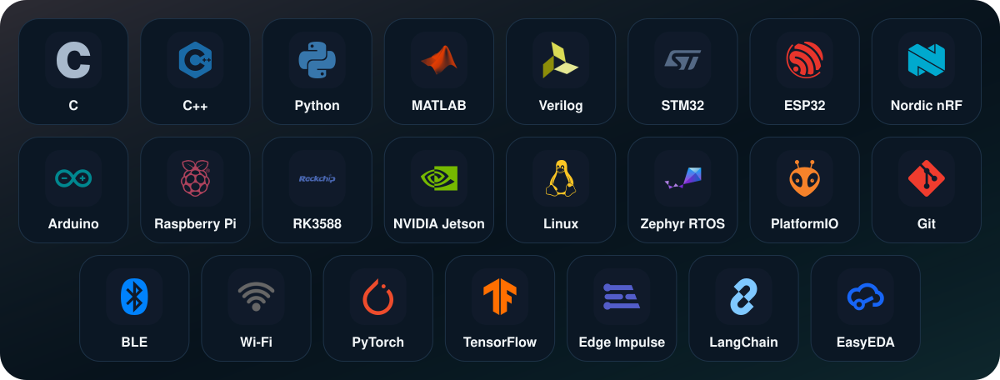</picture></a>

Also SQL, Dart, ESP8266, CH32 (WCH), Teensy, Arm, Xilinx FPGA, FreeRTOS, CMake, MQTT, Modbus RTU, LoRa, WebSockets, Socket.IO, JSON, TFLite Micro, Keras, scikit-learn, OpenCV, ONNX, Hugging Face, LangGraph, OpenAI, Ollama, Qwen, ChromaDB, Proteus, Cadence Virtuoso, Vivado, Nextion, NI Multisim, Docker, Postman, Tailscale, Jira, Figma, Cursor, Claude, Slack, MS Office, Flutter and Android Studio.

<a href="https://muhammadkaif.work"><picture><source media="(prefers-color-scheme: dark)" srcset="assets/footer-dark.svg"><source media="(prefers-color-scheme: light)" srcset="assets/footer-light.svg"></picture></a>

<!-- CH1 trigger armed. If you're reading the source, you'd probably enjoy the site's source too. -->
